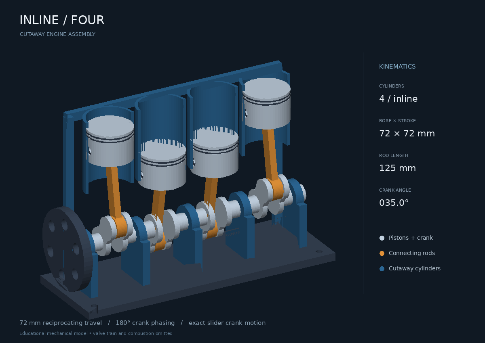

# Inline-Four Engine — CAD Design & Motion Animation



## Overview

An educational cutaway model of an inline-four reciprocating engine, developed to demonstrate mechanical component design, assembly, and slider-crank motion. I modeled **11 distinct component designs** and brought them together into an engine assembly, with a motion animation illustrating the relationship between the crankshaft, connecting rods, and pistons.

The visualization focuses on the mechanical motion of the engine; the valve train and combustion are not modeled.

## Project highlights

- Created 11 individual CAD component models from scratch.
- Assembled the parts into a four-cylinder cutaway engine model.
- Produced a motion animation to illustrate piston travel and crankshaft rotation.
- Exported the assembly and component geometry in STEP format for CAD interoperability.

## Design details shown in the project visualization

| Parameter | Value |
| --- | --- |
| Configuration | Inline four-cylinder |
| Bore × stroke | 72 × 72 mm |
| Connecting rod length | 125 mm |
| Piston travel | 72 mm |
| Crank phasing | 180° |

*These values describe the educational CAD visualization; they are not validated engine performance specifications.*

## Preview and animation

- [Engine motion animation (MP4)](Media/Engine_Motion.mp4)
- [Engine preview image](Media/Engine_Preview.png)
- [Additional still frame](Media/Engine_Motion_Still.png)

> GitHub may not preview every CAD file directly. Use the images and MP4 for a quick look, or download the STEP files into a compatible CAD application.

## Repository structure

```text
Inline-Four-Engine-Portfolio/
├── CAD/
│   ├── Assembly/
│   │   └── Inline_Four_Assembly.step
│   └── Parts/
│       ├── base.step
│       ├── compression_ring.step
│       ├── connecting_rod.step
│       ├── crankshaft.step
│       ├── cutaway_liner.step
│       ├── flywheel.step
│       ├── main_bearing_support.step
│       ├── piston.step
│       ├── rear_post.step
│       ├── rear_rail.step
│       └── wrist_pin.step
├── Media/
│   ├── Engine_Preview.png
│   ├── Engine_Motion.mp4
│   └── Engine_Motion_Still.png
└── README.md
```

## Files and compatibility

The STEP files are exported neutral CAD geometry and can be imported into SolidWorks or other STEP-compatible CAD programs. Native SolidWorks part (`.SLDPRT`), assembly (`.SLDASM`), and motion-study files are **not included** in this repository.

## Resume description

**Inline-Four Engine Design & Motion Animation | SolidWorks / CAD**

- Independently designed 11 distinct engine components and integrated them into a four-cylinder cutaway assembly.
- Created an animation illustrating synchronized piston and crankshaft motion to communicate slider-crank mechanism behavior.

## Notes

This is an educational mechanical model rather than a complete, production-ready engine. It does not include combustion, valve timing, or validated structural/thermal performance analysis.
